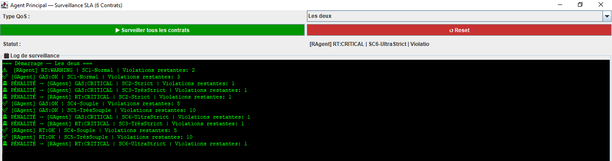
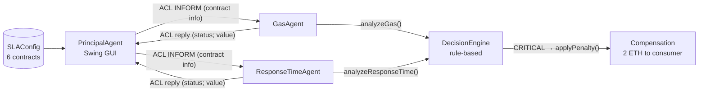
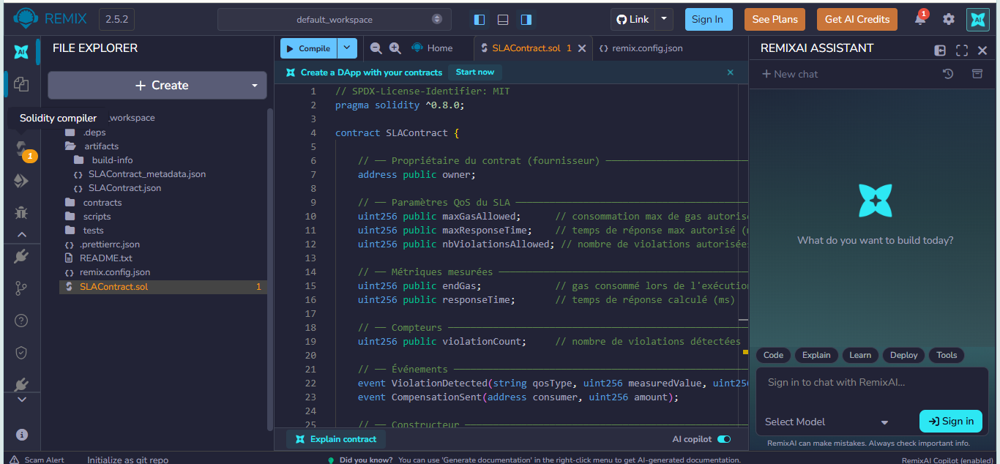
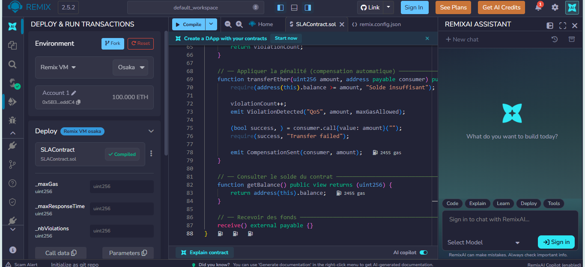
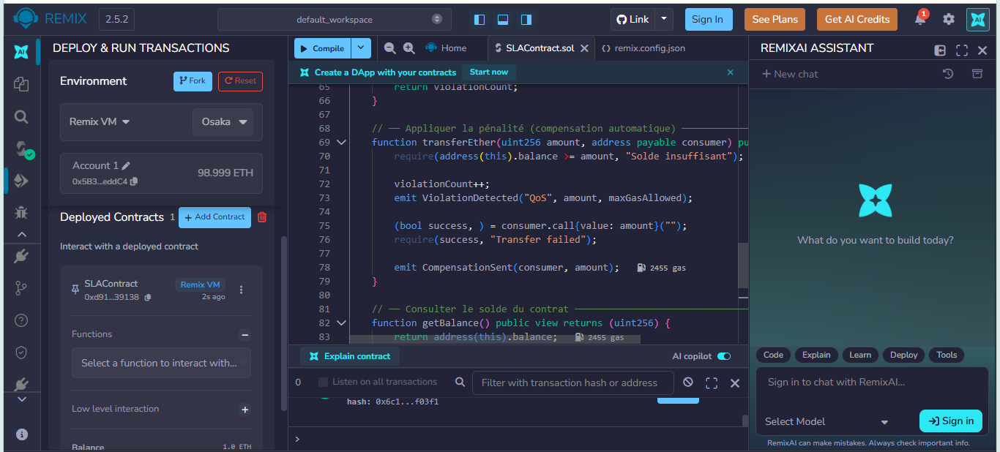
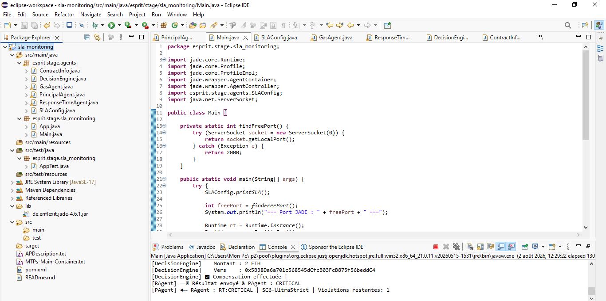

# SLA Monitoring: Multi-Agent System for Smart Contracts

A multi-agent system built with **JADE** that monitors the Quality of Service (QoS) of Ethereum smart contracts, detects **SLA violations** and triggers a compensation through a rule-based decision engine.

> Summer internship project (1 July – 31 August 2026) at **ESPRIT-TECH, R&D and Innovation Department** (Esprit SmartNet team), supervised by Mrs. Nawal HAMDI.



## Overview

Smart contracts execute automatically, but nothing guarantees that the service they provide meets the quality agreed between provider and consumer. This project explores how a set of autonomous agents can watch that quality and react without human intervention or a central trusted party.

- A **Principal Agent** provides a Swing GUI and sends each contract to the monitoring agents.
- A **Gas Agent** and a **Response-Time Agent** each check one QoS criterion.
- A **Decision Engine** classifies every measurement as `OK`, `WARNING` or `CRITICAL` and triggers a penalty when needed.
- Contracts are described in a single configuration class, so **adding a contract requires no change to the agents**.

## Architecture



Agents talk to each other with **FIPA-ACL** messages. Results come back to the principal agent and are shown in the log, with one icon per decision.

## Decision rules

| Metric | OK | WARNING | CRITICAL |
|---|---|---|---|
| Gas consumed | ≤ 100 % of max | ≤ 120 % of max | > 120 % of max |
| Response time | ≤ 100 % of max | ≤ 150 % of max | > 150 % of max |

A penalty is applied when a measurement is `CRITICAL`, or when the number of violations allowed for the contract is used up. The rules are deliberately simple so every decision can be explained and traced.

## Monitored contracts

Six `SLAContract` instances with different SLA parameters were deployed to validate that the design is generic:

| # | Name | Max gas | Max response time | Violations allowed |
|---|---|---|---|---|
| SC1 | Normal | 100 000 | 30 ms | 3 |
| SC2 | Strict | 80 000 | 20 ms | 2 |
| SC3 | Very strict | 50 000 | 10 ms | 1 |
| SC4 | Flexible | 120 000 | 50 ms | 5 |
| SC5 | Very flexible | 150 000 | 100 ms | 10 |
| SC6 | Ultra strict | 30 000 | 5 ms | 1 |

Result of one monitoring cycle: the strict contracts (SC2, SC3, SC6) are flagged `CRITICAL` and penalised, while the flexible ones (SC4, SC5) stay `OK`.

## Screenshots

| Smart contract in Remix IDE | Deployment on Remix VM |
|---|---|
|  |  |

| Deployed contract | Java project and JADE console |
|---|---|
|  |  |

## Tech stack


| Technology | Role |
|---|---|
| Java 17 | Agents, decision engine and GUI (Swing) |
| JADE 4.6.1 | Multi-agent framework and FIPA-ACL messaging |
| Solidity 0.8.x, Remix IDE | Smart contract `SLAContract`, deployed on Remix VM |
| Web3j 4.9.8 | Java ↔ Ethereum library (declared dependency, see limitations) |
| Ganache | Local Ethereum test accounts |
| Maven, JUnit 4 | Build and unit tests |

## Getting started

### Prerequisites
- JDK 17 and Maven
- The JADE 4.6.1 jar, named `de.enflexit.jade-4.6.1.jar` (JADE is not stored in this repository; get it from the [enflexit/jade](https://github.com/enflexit/jade) project or from the official JADE distribution)

### Run

```bash
git clone https://github.com/mouadh12-code/sla-monitoring.git
cd sla-monitoring
mkdir lib
# copy de.enflexit.jade-4.6.1.jar into lib/
mvn compile
```

Then run `esprit.stage.sla_monitoring.Main` (from Eclipse: *Run As → Java Application*). The JADE platform starts on a free port together with three agents (`PAgent`, `GAgent`, `RAgent`).

In the window, choose the QoS type (gas, response time or both) and click **Surveiller tous les contrats** to run one monitoring cycle. **Reset** clears the log.

### Deploy the smart contracts (optional)

1. Open [Remix IDE](https://remix.ethereum.org) and create `SLAContract.sol` from `contracts/SLAContract.sol`.
2. Compile it and deploy six instances on **Remix VM** with the parameters of the table above.
3. Put the deployed addresses in `SLAConfig.java` (`CONTRACT_LIST`).

### Run the tests

```bash
mvn test
```

The tests cover the decision rules of `DecisionEngine` (`OK` / `WARNING` / `CRITICAL` thresholds, including the 120 % and 150 % boundaries).

### Add a new contract

Add one line in `SLAConfig.CONTRACT_LIST`:

```java
CONTRACT_LIST.add(new ContractInfo(
    "0xYourContractAddress", "SC7-Custom", 90000, 25, 2, DEFAULT_CONSUMER));
```

No change is needed in `GasAgent`, `ResponseTimeAgent` or `DecisionEngine`.

## Project structure

```
sla-monitoring/
├── contracts/
│   └── SLAContract.sol            # Solidity smart contract
├── docs/images/                   # Screenshots used in this README
├── src/main/java/esprit/stage/
│   ├── agents/
│   │   ├── PrincipalAgent.java    # GUI and coordination
│   │   ├── GasAgent.java          # Gas monitoring
│   │   ├── ResponseTimeAgent.java # Response-time monitoring
│   │   ├── DecisionEngine.java    # Rules and penalty
│   │   ├── ContractInfo.java      # Contract data and ACL serialization
│   │   └── SLAConfig.java         # Monitored contracts
│   └── sla_monitoring/
│       └── Main.java              # Starts the JADE platform and agents
├── src/test/java/esprit/stage/agents/
│   └── DecisionEngineTest.java
├── pom.xml
└── LICENSE
```

## Current limitations

This is a prototype built during a two-month internship. To be clear about its scope:

- **Measurements are simulated.** Gas and response time are generated on the Java side, not read from the deployed contracts through Web3j.
- **The compensation is simulated.** On a `CRITICAL` decision the system logs a 2 ETH transfer; it does not yet call `transferEther()` on the contract.
- **Monitoring is manual.** A cycle starts with a button click; there is no periodic monitoring yet.
- **The decision approach is intentionally simple** (if/then rules), with no handling of ambiguous cases or prediction.

## Roadmap

- [ ] Real Web3j integration: read metrics from the contracts and send real compensation transactions
- [ ] Periodic monitoring with a JADE `TickerBehaviour`
- [ ] Fuzzy logic in the decision engine to separate minor and major violations
- [ ] Deployment on a public testnet (Sepolia)
- [ ] Persistent history of violations and compensations

## Author

**Mouadh Laajili**, software engineering student at ESPRIT (TWIN), looking for a PFE internship starting January 2027.

- LinkedIn: [mouadh-laajili](https://www.linkedin.com/in/mouadh-laajili)
- GitHub: [@mouadh12-code](https://github.com/mouadh12-code)

## License

Released under the [MIT License](LICENSE).
